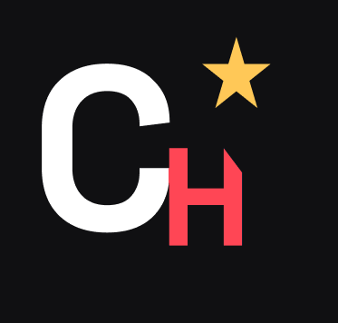

# CritHit

**"Letterboxd para jogos"**: registre os jogos que você jogou, dê uma nota de 1 a 5 estrelas e escreva sua crítica, como numa plataforma de avaliação de filmes. E, sem cadastrar jogo por jogo, **importe sua biblioteca Steam e sua conta PlayStation**, com horas jogadas, conquistas, troféus e platinas.

Projeto integrado da disciplina **Cross-Platform Application Development** (Ciência da Computação, 2º ano), desenvolvido em **Flutter/Dart** ao longo dos Checkpoints 4, 5 e 6.

- **📱 APK para Android:** [página de Releases](https://github.com/LucasFLima21122/crithit/releases/latest) (instruções em [Instalar o APK](#instalar-o-apk))
- **▶ Versão web, sem instalar nada:** [lucasflima21122.github.io/crithit](https://lucasflima21122.github.io/crithit/)

<p align="center">
  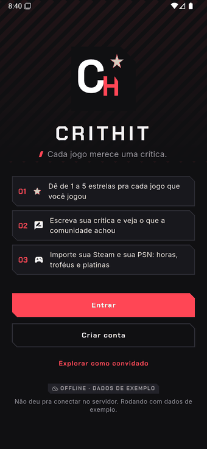
  <br />
  <sub><b>Demonstração</b>: o APK rodando no emulador Android (Pixel 7, Android 16)</sub>
</p>

## Proposta de valor

Hoje, avaliar jogos é uma experiência fragmentada: nota de crítica especializada num site, review de compra na loja digital, opinião pessoal perdida em um grupo do WhatsApp, e o histórico do que você jogou preso dentro de cada plataforma. O **CritHit** junta tudo isso num lugar só, focado na experiência de quem joga: um catálogo onde qualquer pessoa dá sua nota (1 a 5 estrelas) e escreve uma crítica, vê o que a comunidade achou e traz o próprio histórico da Steam e da PlayStation.

Documentação completa: [produto](docs/PRODUCT.md) · [marca e identidade visual](docs/BRANDING.md) · [pitch](docs/PITCH.md) · [configuração do Supabase, Steam e PSN](docs/SUPABASE_E_STEAM.md).

## Integrantes do grupo

| Nome | RM | Papel no projeto |
|---|---|---|
| Felipe Krzyanovski do Santos Menezes | 564878 | Coordenação geral / Product Owner |
| Lucas Ferrari Lima | 563119 | Desenvolvimento Geral do App |
| Carlos Eduardo Pires Cervelli | 563462 | Apoio ao Desenvolvimento e Organização do Repositório |
| Leonardo Lopes Oliveira | 565437 | Identidade visual: logo, paleta de cores, tipografia, Figma |
| Arthur de Souza Matos Dias | 566068 | Documentação: problema, público-alvo, MVP (`docs/PRODUCT.md`) |
| Guilherme Carreri Giampietro | 565676 | Pitch: modelo de negócio e diferencial competitivo (`docs/PITCH.md`) |
| Mateus Patricio Pereira | 564695 | QA/Testes: validação do build |

## Status por Checkpoint

- [x] **Checkpoint 4 (Idealização)**: marca, identidade visual, documentação inicial, pitch e projeto Flutter inicial rodando com tela inicial (catálogo mockado) e fluxo de avaliação por estrelas.
- [x] **Checkpoint 5 (Protótipo funcional)**: fluxo completo do MVP navegável, dados mockados realistas, banco de dados Supabase integrado, importação da biblioteca Steam e ambiente de teste (Chrome/Windows) configurado.
- [x] **Checkpoint 6 (App final)**: MVP completo, identidade visual v2 a partir do feedback do CP5, importação da PlayStation, APK instalável testado no emulador Android e documentação final.

### Entregáveis do Checkpoint 6

| Entregável pedido | Onde está |
|---|---|
| App final (funcionalidades do MVP implementadas) | Os 8 itens do MVP em [`docs/PRODUCT.md`](docs/PRODUCT.md), em 11 telas: ver [Fluxo de telas](#fluxo-de-telas) |
| Qualidade de UI/UX e consistência com a identidade visual | Identidade v2 "HUD", criada a partir do feedback do CP5: ver [O que mudou no CP6](#o-que-mudou-no-checkpoint-6) e [`docs/BRANDING.md`](docs/BRANDING.md) |
| APK instalável, testado em dispositivo/emulador | `flutter build apk --release`, testado no emulador Android (Pixel 7, Android 16): ver [Instalar o APK](#instalar-o-apk) e os [prints](#fluxo-de-telas), todos tirados do APK |
| README completo, arquitetura e aprendizados do grupo | Este README: [Arquitetura](#arquitetura), [Decisões técnicas](#decisões-técnicas) e [Aprendizados do grupo](#aprendizados-do-grupo) |
| Repositório organizado, histórico de commits condizente | Um commit por etapa ([Conventional Commits](https://www.conventionalcommits.org/pt-br/)), do `chore: estrutura inicial` do CP4 até o CP6 |
| Papel de cada membro na documentação | [Integrantes do grupo](#integrantes-do-grupo) |

## O que mudou no Checkpoint 6

### 1. Identidade visual v2: linguagem "HUD"

No CP5 o professor apontou que o visual precisava ser **mais único e característico**. Era verdade: a paleta era a padrão do Tailwind e os componentes eram Material 3 puro, com cantos arredondados, a cara de qualquer app. Na v2, cada elemento novo vem do nome ou do logo:

- **O corte diagonal do "H" do logo virou a assinatura da interface.** Painéis, botões, campos e etiquetas cortam dois cantos opostos, como as placas de HUD de um jogo; capas e avatares cortam só o superior direito, igual ao H. Não sobrou nenhum canto arredondado.
- **Crit Red** (`#FF4655`) no lugar do azul: *critical hit* é o acerto crítico, e nos jogos o dano crítico salta em vermelho.
- **Números como placar** em Chakra Petch, uma fonte angulosa; a nota de um jogo aparece grande, como o "dano" que ele causou.
- **Barras segmentadas**, como barras de vida, em conquistas, troféus, distribuição de notas e XP.
- **"CRITICAL HIT!"**: ao salvar uma review, o acerto salta na tela; nota 5 é um *critical hit* em vermelho, com o XP ganho.
- **Ficha do jogador**: o perfil ganhou nível de crítico, título (Novato → Lenda) e barra de XP.

| Antes (CP5) | Depois (CP6) |
|---|---|
| 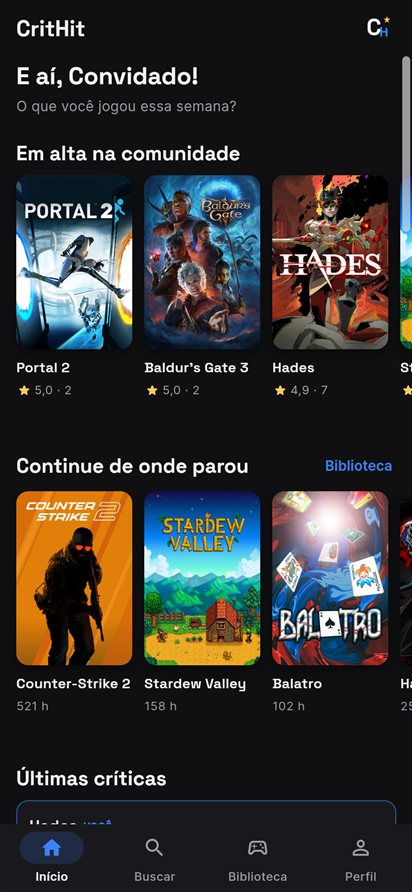 | 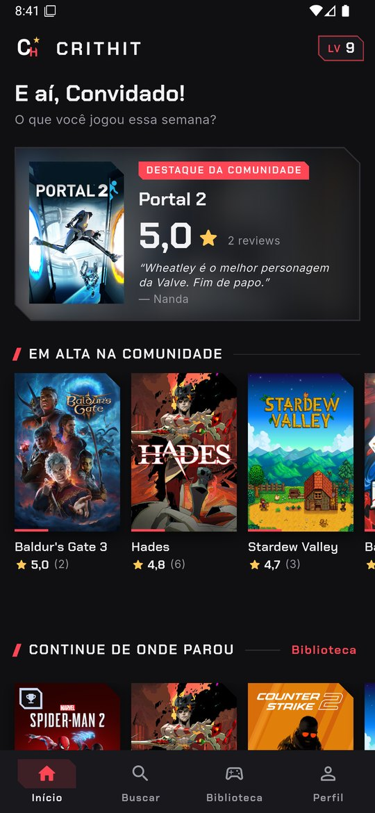 |
| 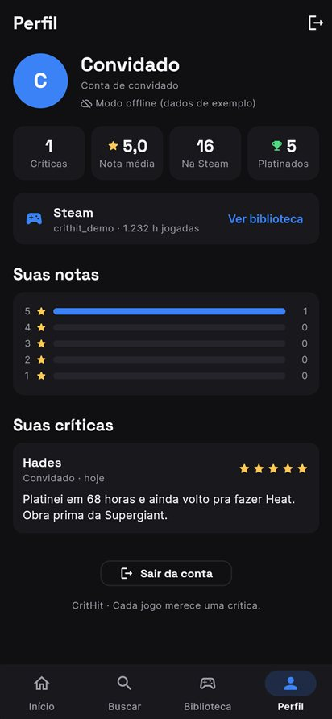 | 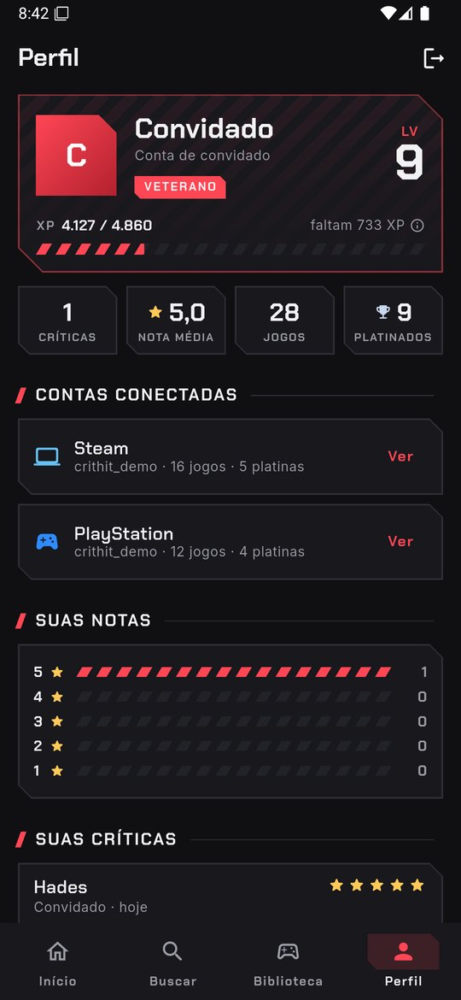 |

### 2. Importação da PlayStation (PSN)

Com o **ID online da PSN**, entram todos os jogos com troféu (de PS3 a PS5) com o progresso e as **platinas de verdade**, mais o tempo de jogo dos jogos de PS4/PS5. Um jogo que a pessoa tem nas duas plataformas, como o Hades, mostra os dois históricos lado a lado. Detalhes em [Integração com a PlayStation](#integração-com-a-playstation).

### 3. App pronto para instalar

- Permissão de internet no manifesto de release (o build de debug ganha de graça, mas o APK final não tinha: sem ela, nada de Supabase, Steam ou PSN).
- Fontes embutidas no app, em vez de baixadas na primeira abertura.
- Ícone e tela de abertura do Android com o logo novo e o fundo escuro da marca (a splash do Android 12+ era branca).
- Fallback offline de verdade: se o servidor não responde ao abrir o app, ele entra no modo de demonstração em vez de quebrar no login (ver [Decisões técnicas](#decisões-técnicas)).

## Fluxo de telas

```
Boas-vindas ──► Entrar / Criar conta ──┐
     └──────► Explorar como convidado ─┤
                                       ▼
        ┌──────────── barra de navegação inferior ────────────┐
        │  Início        Buscar        Biblioteca      Perfil  │
        └─────────────────────────────────────────────────────┘
  Início: destaque da comunidade, em alta, continue de onde parou (Steam + PSN),
          últimas críticas, catálogo
  Buscar: nome/desenvolvedora + filtros (plataforma, gênero, "na minha biblioteca") + ordenação
  Biblioteca: [Steam | PlayStation] ─► conectar ─► jogos, horas, conquistas/troféus, platinas
  Perfil: ficha do jogador (nível e XP), estatísticas, contas conectadas, suas notas e críticas

  Qualquer jogo ─► Detalhe (Steam e/ou PSN) ─► Sua avaliação ─► CRITICAL HIT!
```

Todos os prints abaixo foram tirados do **APK de release** rodando no emulador Android:

| Boas-vindas | Início | Continue de onde parou | Detalhe (Steam + PSN) |
|---|---|---|---|
| 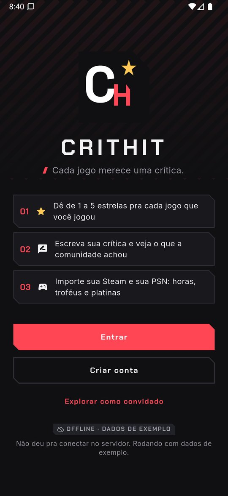 |  | 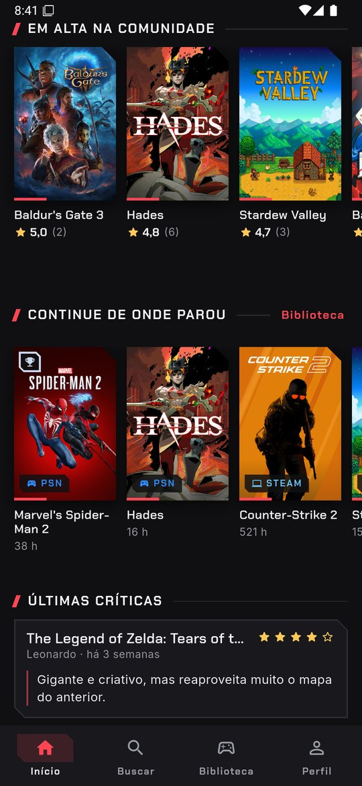 | 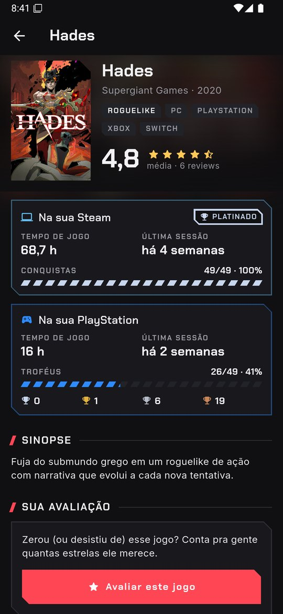 |
| **Sua avaliação** | **CRITICAL HIT!** | **Biblioteca Steam** | **Biblioteca PSN** |
| 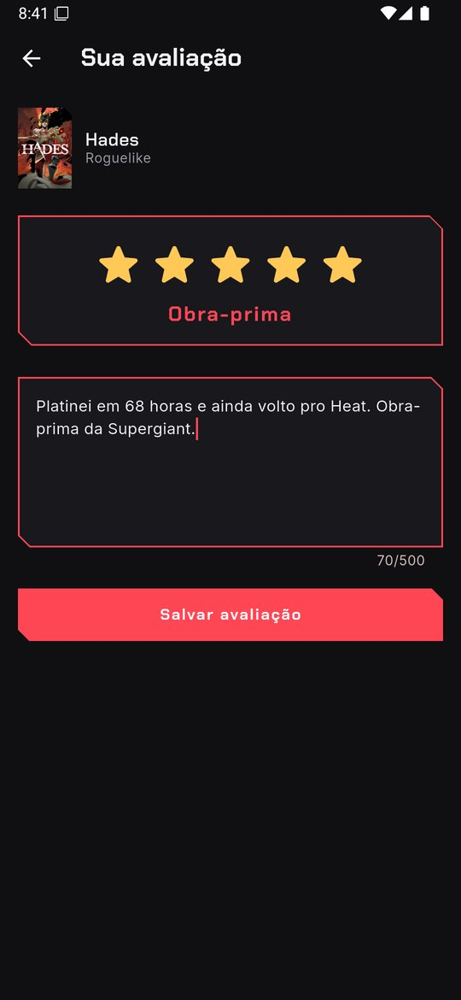 | 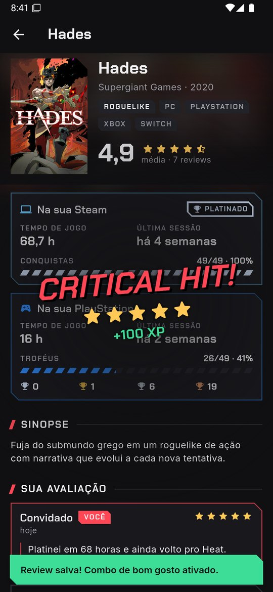 | 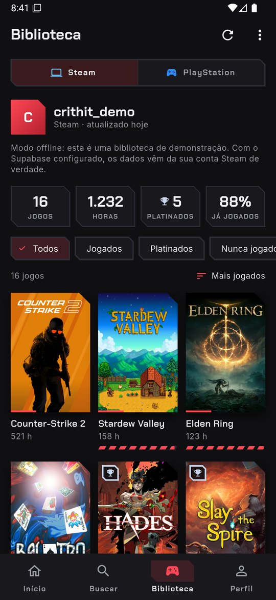 | 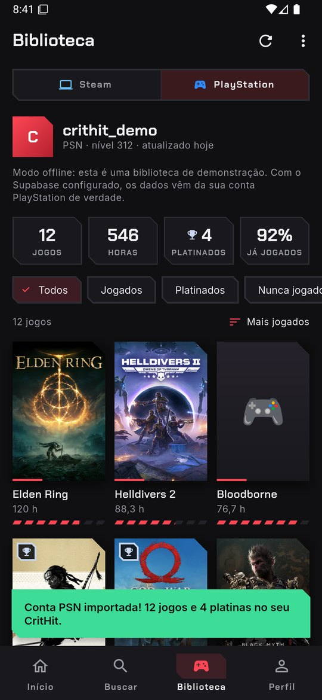 |
| **Conectar PSN** | **Busca** | **Perfil (ficha do jogador)** | |
| 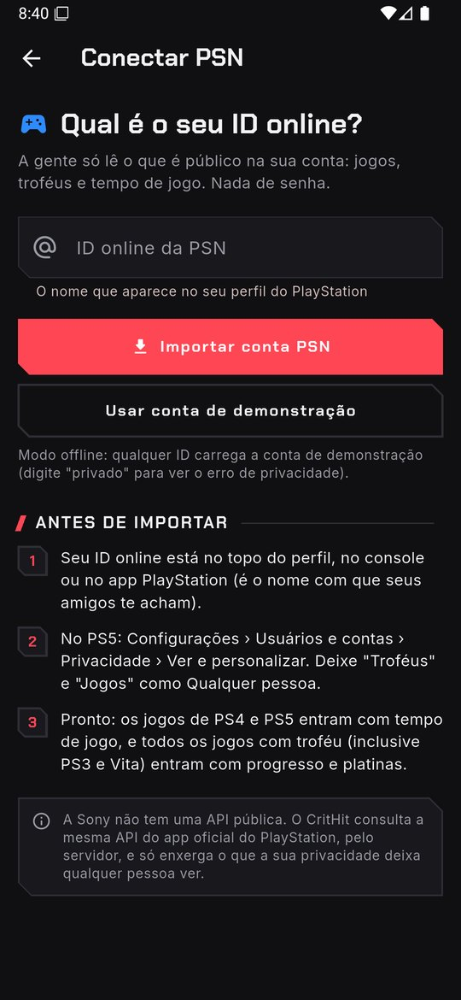 | 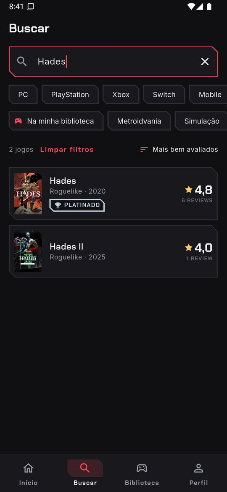 |  | |

## Instalar o APK

1. Baixe o `crithit.apk` na [página de Releases](https://github.com/LucasFLima21122/crithit/releases/latest), no celular ou no computador.
2. No Android, abra o arquivo e permita **"Instalar apps desconhecidos"** para o navegador ou gerenciador de arquivos quando ele pedir.
3. Abra o **CritHit**. Na tela de boas-vindas, a etiqueta mostra o modo: **ONLINE · SUPABASE** (login, reviews, Steam e PSN reais) ou **OFFLINE · DADOS DE EXEMPLO** (sem internet ou com o servidor fora do ar). Se abrir offline porque o aparelho ainda estava sem internet, toque em **"Tentar conectar de novo"**.

Tudo o que o modo online precisa vai dentro do APK (endereço e chave pública do Supabase), então ele funciona em qualquer celular ou emulador com internet, sem configurar nada. Num emulador recém-ligado, espere a internet dele subir (dá pra testar abrindo o Chrome) antes de abrir o app.

No emulador do Android Studio: `adb install crithit.apk`, ou arraste o arquivo para a janela do emulador.

Para gerar o APK a partir do código (precisa do Android SDK, que vem com o Android Studio):

```bash
flutter build apk --release --dart-define-from-file=config/env.json
# sai em build/app/outputs/flutter-apk/app-release.apk
```

O APK é universal (arm64, armv7 e x86_64), então roda tanto em celular quanto no emulador. Ele é assinado com a chave de debug, o que basta para instalar direto; para publicar na Play Store seria preciso uma chave de release própria.

## Como rodar o projeto

Pré-requisitos: [Flutter SDK](https://docs.flutter.dev/get-started/install) 3.35 ou mais novo (testado com 3.47) e Google Chrome. Para Android, o Android Studio (SDK + emulador). Para Windows desktop, o Visual Studio com "Desenvolvimento para desktop com C++" e o **Modo de Desenvolvedor** do Windows ligado (os plugins usam links simbólicos).

```bash
# 1. Instale as dependências
flutter pub get

# 2a. Modo OFFLINE: dados mockados, sem precisar de nenhuma chave nem de internet
flutter run -d chrome

# 2b. Modo ONLINE: Supabase (login real, reviews no banco) + Steam e PSN reais
#     Copie config/env.example.json para config/env.json e preencha (ver docs/SUPABASE_E_STEAM.md)
flutter run -d chrome --dart-define-from-file=config/env.json

# Android (emulador aberto ou celular com depuração USB) e Windows: mesmos parâmetros
flutter run -d emulator-5554 --dart-define-from-file=config/env.json
flutter run -d windows

# Análise estática e testes
flutter analyze
flutter test
```

As duas opções já vêm prontas nas IDEs: *CritHit · online (Supabase)* e *CritHit · offline (dados mockados)*.

- **VS Code**: em **Run and Debug** (`.vscode/launch.json`).
- **Android Studio**: no seletor de configurações ao lado do botão ▶ (`.run/`). Use a **online**: a "main.dart" que o Android Studio cria sozinho roda sem o `env.json` e por isso abre no modo offline.

### Modo online × modo offline

| | Offline | Online |
|---|---|---|
| Quando | Sem `env.json`, sem internet ou com o servidor fora do ar | Com `env.json` e o Supabase respondendo |
| Login | Qualquer e-mail válido + senha com 6+ caracteres | Supabase Auth (e-mail/senha ou convidado anônimo) |
| Reviews | Em memória, com 43 reviews de exemplo | Tabela `reviews` no Postgres do Supabase |
| Steam | Biblioteca de demonstração (16 jogos) | Sua conta Steam de verdade, via Edge Function `steam` |
| PlayStation | Conta de demonstração (12 jogos, 4 platinas) | Sua conta PSN de verdade, via Edge Function `psn` |

O app escolhe o modo sozinho ao abrir (`lib/services/app_services.dart`): antes de ligar o Supabase, ele testa se o servidor responde (duas tentativas de até 8 segundos, porque um celular ou emulador recém-ligado pode ainda estar subindo a rede). Se não responder, entra no modo offline e mostra na tela de boas-vindas o botão **"Tentar conectar de novo"**, que passa para o modo online sem fechar o app. A apresentação nunca depende da rede.

## Integração com a Steam

1. Na aba **Biblioteca** (aba Steam) ou no Perfil, toque em **Conectar Steam**.
2. Cole o link do seu perfil (`steamcommunity.com/id/seunick`), o ID personalizado ou o SteamID64.
3. O app importa **todos os jogos da conta**, com horas jogadas, data da última sessão e progresso de conquistas. Jogo com 100% das conquistas ganha o selo **Platinado**.
4. Os jogos aparecem na busca, no "Continue de onde parou" e podem ser avaliados. Se o jogo está no catálogo (ex.: Hades), a review vai para a página da comunidade.
5. A conta fica salva no perfil (`profiles.steam_id`) e é recarregada sozinha no próximo login.

Do lado da Steam, em *Editar perfil → Privacidade*, **"Meu perfil" e "Detalhes de jogos" precisam estar como Público**. O app explica isso na tela e mostra uma mensagem clara se o perfil estiver privado.

Endpoints (Steam Web API): `ISteamUser/ResolveVanityURL`, `ISteamUser/GetPlayerSummaries`, `IPlayerService/GetOwnedGames` e `IPlayerService/GetTopAchievementsForGames` (em lotes de 100 jogos; numa biblioteca real de 195 jogos a importação leva cerca de 2 segundos).

## Integração com a PlayStation

1. Na aba **Biblioteca**, troque para **PlayStation** e toque em **Conectar PSN** (ou pelo Perfil).
2. Digite o **ID online da PSN** (o nome do perfil, não o e-mail).
3. O app importa:
   - **todos os jogos com troféu** (PS3, PS Vita, PS4 e PS5), com o progresso e a contagem de platina, ouro, prata e bronze;
   - o **tempo de jogo e a última sessão** dos jogos de PS4 e PS5.
4. **Platinado** aqui é o troféu de platina de verdade. Os jogos casam com o catálogo pelo nome (a Sony não usa o mesmo id da Steam), então o God of War da PSN cai na mesma página de reviews do God of War do catálogo.
5. A conta fica salva no perfil (`profiles.psn_online_id`) e é recarregada sozinha no próximo login.

Do lado da PSN, em *Configurações › Usuários e contas › Privacidade*, **"Troféus" e "Jogos" precisam estar visíveis para Qualquer pessoa**. São independentes: com só um deles aberto, o app mostra o que der.

Testado com uma conta real (a do Lucas): **210 jogos, 3.552 horas e 13 platinas**, batendo com o perfil oficial (nível 254). Na conta real apareceram casos que a demonstração não tinha, como o mesmo jogo com listas de troféus separadas para PS4 e PS5 e nomes escritos de jeitos diferentes ("Grand Theft Auto V (PlayStation®5)"). Todos viraram testes automatizados.

| Conta PSN real importada | Jogo só da PSN, com troféus reais |
|---|---|
| 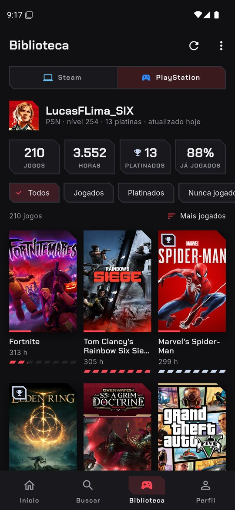 | 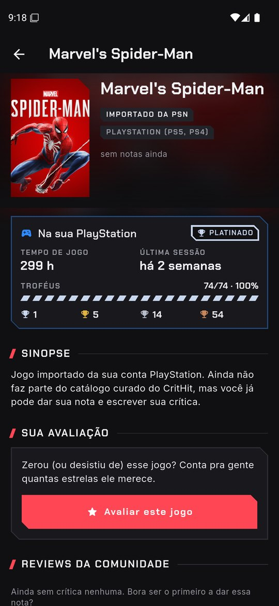 |

**Como funciona sem API pública:** a Sony não oferece API aberta. O CritHit usa a mesma API do app oficial da PlayStation, a mesma usada por sites como PSNProfiles e Exophase e por bibliotecas como [psn-api](https://github.com/achievements-app/psn-api). Ela exige o login de uma conta PSN (um token chamado NPSSO). Esse token fica guardado como **secret** na Edge Function `psn`, nunca no app, e o servidor só aceita 3 consultas de leitura de dados públicos (lista fechada). Como Xbox exige parceria com a Microsoft, ele ficou fora do escopo. Passo a passo em [`docs/SUPABASE_E_STEAM.md`](docs/SUPABASE_E_STEAM.md#8-playstation-psn).

## Estrutura do projeto

```
lib/
  main.dart                     # inicializa os serviços e o Provider
  config/app_config.dart        # chaves lidas via --dart-define (Supabase, Steam, PSN)
  models/
    game.dart, review.dart, app_user.dart
    library.dart                # GamePlatform, OwnedGame e GameLibrary (interface comum)
    steam.dart, psn.dart        # implementações de cada plataforma
  data/                         # catálogo (21 jogos), 43 reviews, Steam e PSN de demonstração
  services/
    app_services.dart           # testa o servidor e decide online × offline
    auth_service.dart           # LocalAuthService / SupabaseAuthService
    review_repository.dart      # LocalReviewRepository / SupabaseReviewRepository
    steam/                      # parser de ID, transporte (direto/Edge Function), importação
    psn/                        # transporte (direto/Edge Function), importação e junção de troféus + tempo de jogo
  state/app_state.dart          # estado compartilhado (ChangeNotifier + Provider)
  screens/                      # 11 telas
  widgets/
    hud.dart                    # HudPanel, SectionHeader, SegmentedBar, HudTag, CRITICAL HIT!
    common.dart, game_*.dart, review_tile.dart, platinum_badge.dart, platform_style.dart...
  theme/                        # paleta, ThemeData e as formas HUD (cantos cortados)
  utils/                        # formatação pt-BR e o nível de crítico (XP)
assets/                         # capas, logo e fontes embutidas (Chakra Petch e Inter)
supabase/
  migrations/                   # schema (profiles + reviews, RLS) e a conta PSN no perfil
  seed.sql                      # reviews de exemplo
  functions/steam/index.ts      # Edge Function: proxy da Steam Web API (guarda a chave)
  functions/psn/index.ts        # Edge Function: proxy da PSN (guarda o NPSSO)
test/                           # widget (fluxos) e unidade (Steam, PSN, nível, modo online)
docs/                           # produto, marca, pitch, guia de configuração e prints
```

## Arquitetura

```
 Telas (screens/) ──watch/read──► AppState (ChangeNotifier, via Provider)
                                      │
      ┌──────────────┬────────────────┼──────────────────┬──────────────────────┐
      ▼              ▼                ▼                  ▼                      │
 AuthService  ReviewRepository  SteamLibraryService  PsnLibraryService          │
 Local│Supabase Local│Supabase   Demo│Remote(SteamApi) Demo│Remote(PsnApi)      │
                                       │                    │                   │
                     DirectSteamApi ◄──┴──► Edge Function   DirectPsnApi ◄──┴──► Edge Function
                     (teste local)          "steam"         (teste local)        "psn"

 Steam e PSN devolvem bibliotecas diferentes, mas as telas só enxergam a interface comum:
     SteamOwnedGame ─┐                     SteamLibrary ─┐
                     ├─► OwnedGame                       ├─► GameLibrary
     PsnOwnedGame  ──┘   (horas, conquistas,  PsnLibrary ──┘   (conta, jogos, totais)
                          platina, última sessão)
```

As telas dependem só das **interfaces**; `AppServices` escolhe as implementações. Foi isso que permitiu:

- trocar dados mockados por dados reais no CP5 sem mudar nenhuma tela;
- adicionar a PlayStation no CP6 sem duplicar a Biblioteca, o "Continue de onde parou" nem o detalhe do jogo. Eles trabalham com `OwnedGame`/`GameLibrary`, e a PSN só precisou implementar as duas interfaces;
- rodar os testes 100% offline.

## Decisões técnicas

### Desde o CP4 (registradas no CP5)

- **Supabase em vez de Firebase**: o modelo é relacional (usuário → reviews → jogo), então Postgres com Row Level Security encaixa melhor que documentos, e as Edge Functions resolvem os proxies no mesmo serviço.
- **Segurança por RLS**: qualquer pessoa lê perfis e reviews, mas cada usuário só cria, edita e apaga o que é dele (`auth.uid() = user_id`). A chave pública pode ficar no app; quem protege os dados é o banco.
- **Uma review por usuário por jogo**: `unique (user_id, game_id)` + `upsert`. Avaliar de novo edita, como no Letterboxd.
- **Steam via Edge Function**: a Steam não libera CORS e a chave não pode ir no APK. A função guarda a chave como secret e só repassa uma lista fechada de métodos.
- **Provider para estado compartilhado**: sessão, reviews e bibliotecas são usadas por várias telas ao mesmo tempo, então ficaram num `AppState` central.
- **`NavigationBar` + `IndexedStack`**: quatro abas que preservam o estado de cada uma (scroll, filtros).
- **Capas em cascata**: capa local → capa por URL (PSN) → capa da Steam → banner da Steam → emoji. A tela nunca quebra por falta de imagem.
- **Layout responsivo**: largura máxima de 760 px; a grade da biblioteca ajusta o número de colunas.
- **Deploy automático no GitHub Pages** a cada push no `master` (`.github/workflows/deploy-web.yml`).

### No CP6

- **Interface comum de biblioteca (`OwnedGame`/`GameLibrary`)** em vez de telas duplicadas para cada plataforma.
- **PSN pela API do app oficial, com o token no servidor**: era o único caminho sem parceria com a Sony. O NPSSO vale como a senha da conta, então nunca vai para o app: fica como secret na Edge Function `psn`, que aceita só 3 consultas de leitura. Há um modo direto (`--dart-define=PSN_NPSSO`) só para teste local em desktop.
- **Juntar duas listas da Sony num jogo só**: troféus e tempo de jogo vêm de endpoints diferentes, com ids diferentes. A junção é pelo nome normalizado (`Game.matchKey`), e as versões PS4 e PS5 do mesmo jogo (mesmo `concept`) somam o tempo. Testado com respostas no formato real da API.
- **Privacidade parcial não é erro**: "Troféus" e "Jogos" têm privacidade separada na PSN. Se só uma estiver aberta, o app importa o que der; só falha se as duas estiverem fechadas.
- **Formas HUD no tema, não em cada tela**: o canto cortado está no `ThemeData` (botões, campos, chips, diálogos, menus) e em poucos widgets (`HudPanel`, `HudShapes`). Mudar o corte ou a cor é mexer em um lugar só.
- **Fontes embutidas** (`assets/fonts/`) em vez de `google_fonts`, para o APK funcionar offline desde a primeira abertura.
- **Checagem do servidor antes do modo online**: o `Supabase.initialize` não faz nenhuma chamada de rede, então "dava certo" mesmo com o servidor fora do ar, e o app quebrava só no login. Agora o app consulta `/auth/v1/health` antes de decidir, tenta duas vezes (rede ainda subindo num emulador recém-ligado) e, se cair para offline, deixa reconectar pela tela de boas-vindas.
- **Nível de crítico calculado, não salvo**: o XP sai das reviews e bibliotecas que já existem, sem tabela nova nem risco de ficar dessincronizado.

## Testes

`flutter test` roda **44 testes**, todos offline:

- **Fluxos de widget** (`test/widget_test.dart`): boas-vindas; cadastro com validação; avaliar um jogo (sem nota → erro; com nota → "HIT!" com +100 XP, review no perfil); conectar Steam (perfil privado → erro; demonstração → 16 jogos, platinados, detalhe com conquistas); **conectar PSN** (privacidade fechada → erro; demonstração → 12 jogos e 4 platinas, exclusivo fora do catálogo, God of War casando com o catálogo e mostrando os troféus); busca com filtros e estado vazio.
- **PSN** (`test/psn_test.dart`): leitura do ID online, duração ISO 8601, comparação de títulos entre plataformas (com nomes reais da Sony, como "Grand Theft Auto V (PlayStation®5)"), junção de troféus + tempo de jogo (PS4 + PS5 somados, listas de troféus separadas por console, jogo só com troféus, jogo só no histórico), privacidade parcial e total, conta inexistente.
- **Steam** (`test/steam_test.dart`): parser de link/ID, importação com platinas, ID personalizado, perfis privados e falha nas conquistas sem quebrar a biblioteca.
- **Nível de crítico** (`test/player_level_test.dart`), **modo online × offline e reconexão** (`test/app_services_test.dart`) e **formatação** (`test/formatters_test.dart`).

Os testes de widget pegaram, no CP6, dois textos que estouravam a largura do card de destaque em telas estreitas, antes de irem para o APK.

## Aprendizados do grupo

- **Feedback de design se responde com identidade, não com enfeite.** O primeiro impulso para "deixar mais único" seria adicionar gradientes e animações. O que funcionou foi olhar para o que a marca já tinha (o nome *critical hit*, o corte do H do logo) e transformar isso em regra visual aplicada no tema inteiro. Assim o resultado ficou consistente, e não um conjunto de telas enfeitadas.
- **Integrar com plataforma fechada é mais sobre limites do que sobre código.** Na Steam, o endpoint "óbvio" de conquistas recusava a chave da Web API; na PSN não existe API pública. Nos dois casos o trabalho foi entender o que é permitido, onde guardar credenciais (nunca no app) e como explicar a privacidade para o usuário.
- **Abstrair na hora certa compensa.** Começamos só com a Steam, com modelos específicos. Quando a PSN chegou, extrair a interface `OwnedGame` custou pouco e evitou duplicar três telas. Se tivéssemos abstraído no CP5, sem a segunda plataforma, provavelmente teríamos desenhado a interface errada.
- **O APK é outro ambiente.** Coisas que funcionavam no Chrome e no `flutter run` falharam no build de release: faltava a permissão de internet (o debug ganha de graça), as fontes eram baixadas da rede e a splash do Android 12+ era branca. Só testando o APK de verdade, num emulador, isso apareceu.
- **"Funciona offline" precisa ser testado com o servidor caído.** O fallback do CP5 cobria a falta de configuração, mas não um servidor fora do ar. Descobrimos isso quando o projeto gratuito do Supabase foi pausado por inatividade, e viramos o caso num teste automatizado.
- **Dados mockados bons são casos de teste.** As bibliotecas de demonstração cobrem de propósito platina, backlog, jogo sem conquistas, jogo fora do catálogo e o mesmo jogo em duas plataformas. Foram elas que permitiram testar e apresentar tudo sem depender de conta real.
