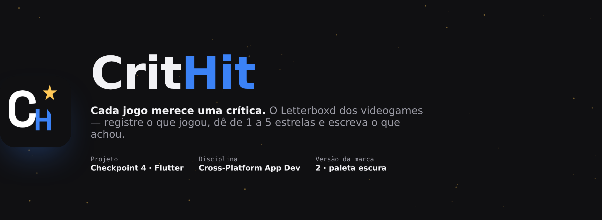
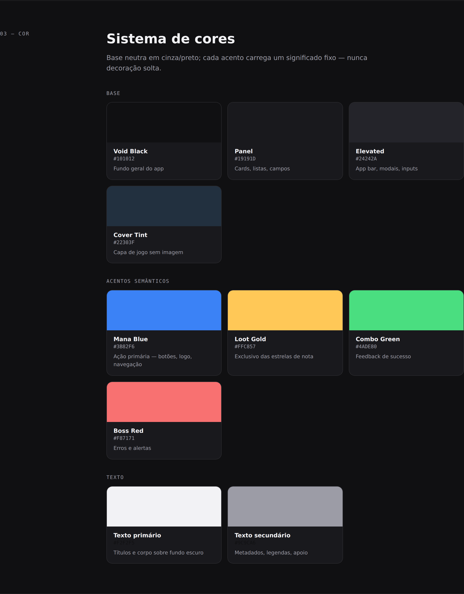
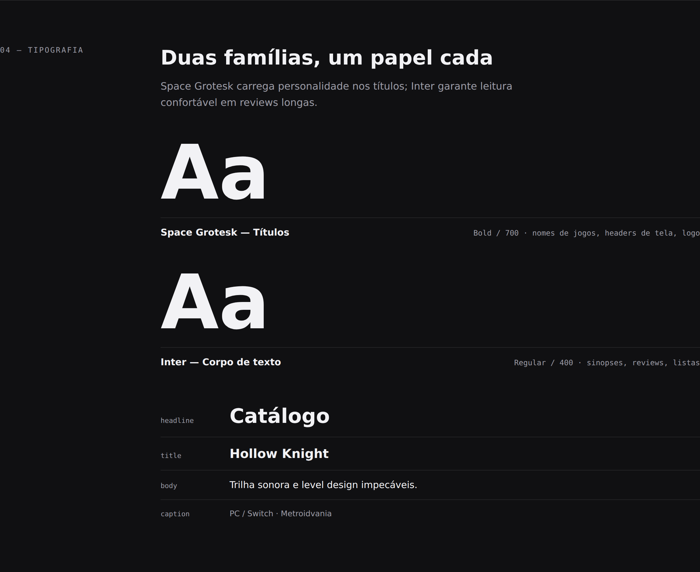
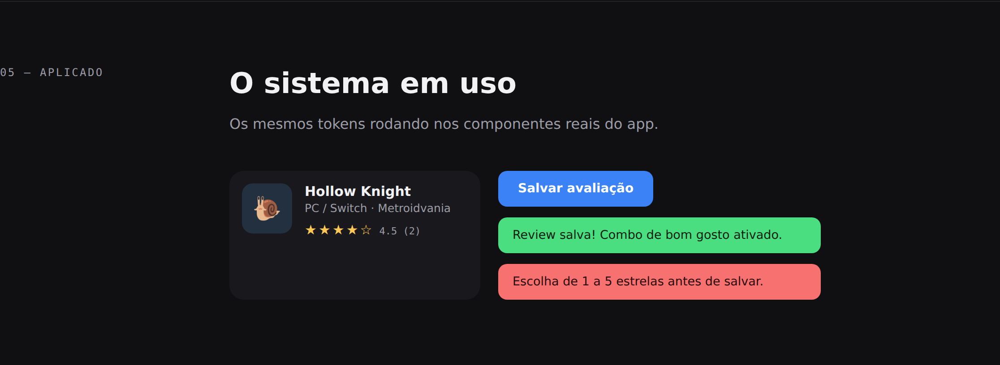

# Marca — CritHit

## Nome

**CritHit**

### Naming rationale

"Crit Hit" (Critical Hit / acerto crítico) é um termo que qualquer jogador reconhece na hora: é aquele ataque que sai com dano extra, o momento de sorte e habilidade que vira o jogo. A gente pegou esse termo e sobrepôs um segundo significado: **"Crit"** também é a raiz de *crítica* e *critique*, exatamente o que o app faz, permitir que jogadores critiquem os jogos que jogaram.

O nome funciona em três camadas:

1. **Gamer**: reconhecível instantaneamente por quem joga, sem precisar explicar.
2. **Produto**: comunica a função central do app, dar uma nota e escrever uma crítica.
3. **Memorável**: curto (7 letras), fácil de falar em português e em inglês, funciona como `@crithit` em qualquer rede social e como domínio (`crithit.app`).

Tagline: **"Cada jogo merece uma crítica."**

## Tom de voz

O CritHit fala como um amigo gamer experiente que também manja de crítica, não como uma enciclopédia nem como uma marca corporativa. Diretrizes:

- **Direto e leve**: frases curtas, sem enrolação. Nada de jargão corporativo ("sinergia", "solução disruptiva").
- **Vocabulário gamer com moderação**: termos como *combo*, *loot*, *backlog*, *platinar* aparecem naturalmente, mas sem forçar gíria em toda frase.
- **Encorajador, nunca elitista**: qualquer pessoa pode dar uma nota e escrever duas linhas, o app não julga quem não é "hardcore".
- **Opinativo, mas respeitoso**: incentiva o usuário a ter e defender uma opinião sobre os jogos, sem tom de ataque a quem pensa diferente.

Exemplos de microcopy:

| Contexto | Texto |
|---|---|
| Tela vazia de reviews | "Ainda sem crítica nenhuma. Bora ser o primeiro a dar essa nota?" |
| Confirmação ao salvar review | "Review salva! Combo de bom gosto ativado." |
| Erro genérico | "Deu ruim aqui do nosso lado. Tenta de novo?" |
| Convite para avaliar | "Zerou (ou desistiu de) esse jogo? Conta pra gente quantas estrelas ele merece." |

## Identidade v2 (Checkpoint 6): linguagem "HUD"

No feedback do CP5, o professor apontou que o visual precisava ser **mais único e característico**. O diagnóstico do grupo: a paleta era literalmente a padrão do Tailwind (`#3B82F6`, `#4ADE80`, `#F87171`) e o resto eram componentes Material 3 com cantos arredondados, a cara de qualquer app. A v2 mantém a base escura e o significado das cores, mas troca o que era genérico por elementos tirados do próprio nome e do logo:

- **O corte diagonal vem do logo.** O "H" do logo sempre teve o canto superior direito cortado. Esse chanfro virou a assinatura da interface: painéis, botões, campos e etiquetas cortam dois cantos opostos (como as placas de HUD dos jogos) e as capas e avatares cortam só o superior direito, igual ao H. Não existe mais nenhum canto arredondado no app (`lib/theme/hud_shapes.dart`).
- **"Crit Red" no lugar do azul.** *Critical hit* é o acerto crítico, e nos jogos o número do dano crítico salta em vermelho. A cor da marca e da ação virou o Crit Red, e o H do logo foi recolorido junto.
- **Números como placar.** Notas, horas, nível e contadores usam Chakra Petch, uma fonte angulosa que combina com os cortes, em tamanho grande: a nota de um jogo aparece como o "dano" que ele causou.
- **Barras segmentadas.** Progresso de conquistas/troféus, distribuição de notas e XP usam barras em segmentos inclinados, como a barra de vida de um personagem (`SegmentedBar`).
- **Momento "CRITICAL HIT!".** Ao salvar uma review, o acerto salta na tela como número de dano; nota 5 é um *critical hit* em vermelho, e a primeira crítica de um jogo mostra o XP ganho.
- **Ficha do jogador.** O perfil virou uma ficha de RPG: nível de crítico, título (Novato → Aventureiro → Crítico → Veterano → Lenda) e barra de XP. Crítica com texto vale 100 XP, só a nota 50, cada platina 250 e cada hora jogada 1 XP. A regra aparece no próprio app.
- **Seções como HUD.** Os títulos de seção viram rótulos em caixa alta, com uma marca vermelha inclinada e um fio até a borda.

## Paleta de cores

Base neutra em tons de cinza/preto (a mesma do fundo do logo), com acentos coloridos usados com significado. Não é "cor por decoração": cada uma marca um estado diferente da interface.

| Token | Hex | Uso |
|---|---|---|
| `background` | `#101012` | Fundo geral do app (igual ao fundo do logo) |
| `surface` | `#18181D` | Painéis, cards, campos |
| `surfaceAlt` | `#222229` | Elementos elevados (diálogos, menus), trilhos das barras |
| `stroke` | `#2E2E37` | Contorno fino dos painéis HUD e divisórias |
| `primary` (**Crit Red**) | `#FF4655` | Cor da marca e da ação: botões, navegação, marcas de seção, o H do logo |
| `accentGold` (Loot Gold) | `#FFC857` | Estrelas de avaliação, a cor mais importante do produto |
| `platinum` (Platinum) | `#C9D7EE` | Selo de platina (Steam e PlayStation) |
| `success` (Combo Green) | `#3DDC97` | Estados positivos (ex.: "review salva"), XP ganho |
| `danger` (**Boss Orange**) | `#FF8A3D` | Erros e alertas |
| `textPrimary` | `#F2F2F5` | Texto principal |
| `textSecondary` | `#9C9CA6` | Texto de apoio, metadados |
| `steam` / `playstation` | `#66C0F4` / `#2E8BFF` | Só nos ícones e etiquetas de cada plataforma |

**Regras de uso**:

- **Dourado é exclusivo das estrelas** (desde o CP4), para manter o significado forte.
- **Vermelho é marca e ação**, nunca erro. Por isso o erro saiu do vermelho ("Boss Red") e foi para o laranja ("Boss Orange"): com o Crit Red como cor da marca, um erro vermelho seria confundido com um botão.
- **Platina tem cor própria.** No CP5 o selo usava o verde de sucesso. Com a PlayStation, a platina passou a ser o troféu de verdade, então ganhou a cor do próprio metal. O dourado continua só das estrelas.
- Cores de plataforma (Steam, PlayStation) só aparecem nos ícones e etiquetas delas.

## Tipografia

- **Títulos, números e rótulos HUD**: `Chakra Petch` (geométrica e angulosa, conversa com os cortes diagonais; em caixa alta e espaçada nos rótulos de seção e botões). Substituiu a Space Grotesk do CP4, que era limpa mas pouco característica.
- **Corpo de texto**: `Inter` (alta legibilidade em telas pequenas, ótima para reviews longas e listas). Mantida do CP4.
- **Fontes embutidas**: os arquivos ficam em `assets/fonts/` (licença SIL Open Font License). Até o CP5 elas eram baixadas pelo pacote `google_fonts` na primeira abertura; no APK isso deixaria o app sem a fonte certa quando estivesse offline, então agora vão dentro do app.

## Aplicações do logo

- `docs/brand/logo.png` — símbolo oficial: monograma "Ch" (C branco + H em **Crit Red**, com o canto cortado) e uma estrela dourada, sobre fundo escuro. Na v2 só a cor do H mudou (era Mana Blue).
- `assets/branding/logo.png` — a mesma imagem, dentro do projeto Flutter, usada nas boas-vindas, na barra da tela inicial e no rodapé, sempre recortada com o canto do H. O ícone do app no Android (`android/app/src/main/res/mipmap-*`), os ícones da web (`web/icons/`, `web/favicon.png`) e o do Windows (`windows/runner/resources/app_icon.ico`) foram gerados a partir dela.

> **Próximo passo (opcional)**: essa é a v1 do logo, em PNG. Se o grupo quiser refinar (ajustar proporções, testar em tamanho de ícone bem pequeno), o `docs/GUIA_FIGMA_CRITHIT.md` tem o passo a passo pra recriar como vetor no Figma e exportar um `.svg` — que dá mais nitidez em qualquer tamanho e substitui este PNG sem mudar mais nada.

## Mini brandbook (HTML)

> O brandbook HTML e os prints abaixo são do **Checkpoint 4 (identidade v1)**, com o azul e a Space Grotesk. A identidade atual é a v2 descrita acima; os prints do app com ela aplicada estão no README (`docs/screenshots/cp6/`).

Além desta documentação em Markdown, montamos um **mini brandbook navegável** reunindo nome, tom de voz, paleta, tipografia e aplicações do logo em uma única página, com a identidade visual já aplicada nela mesma (fundo escuro, tipografia da marca, cores oficiais).

- Arquivo interativo: [`docs/brand/brandbook.html`](brand/brandbook.html) — abre em qualquer navegador, sem precisar de internet nem de instalar nada.
- Prints da página:

  
  

  
  

